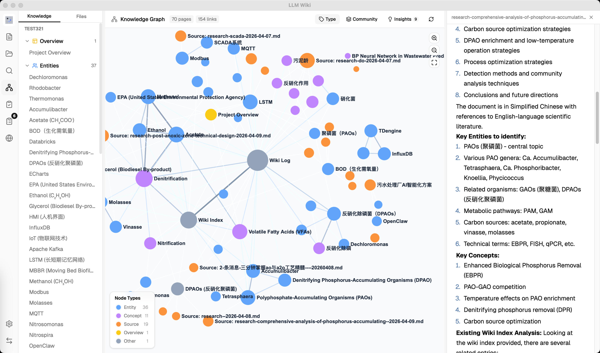
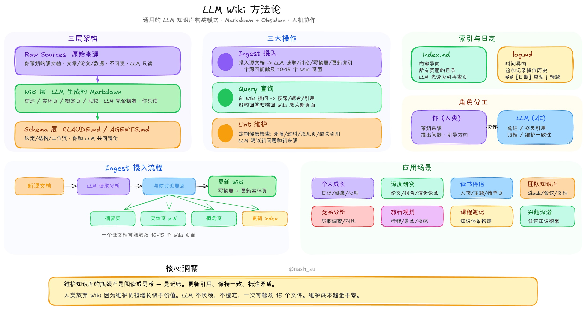
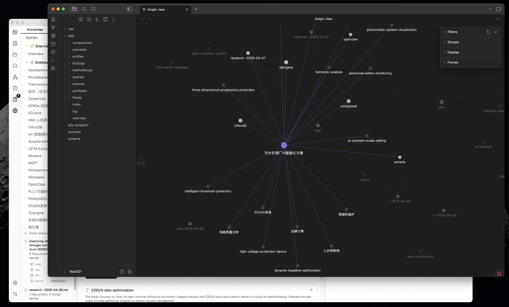
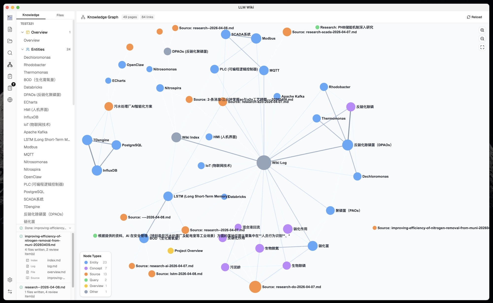
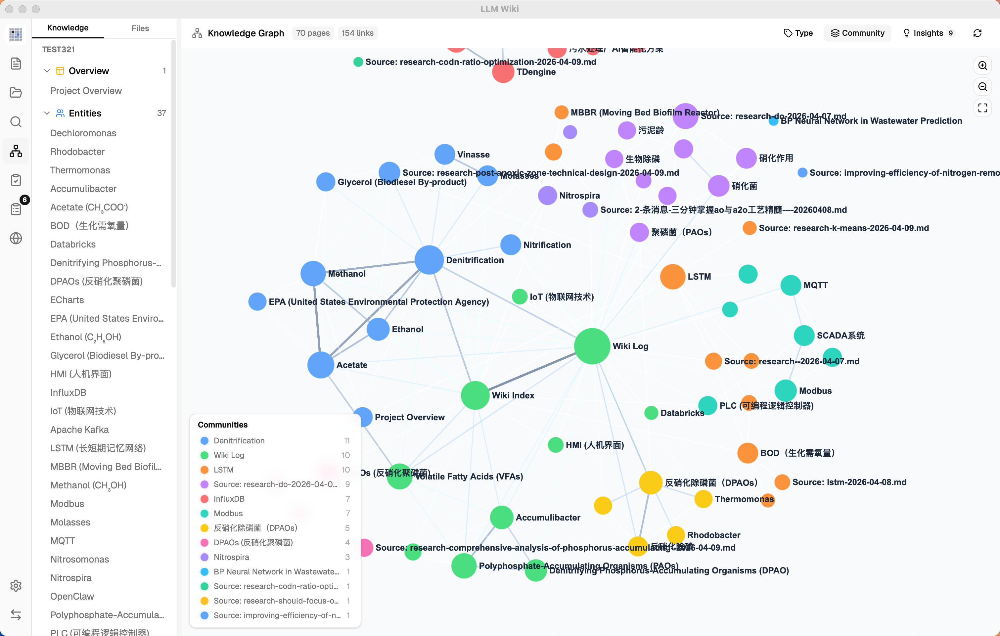
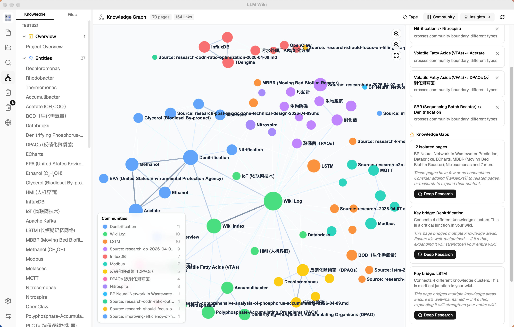
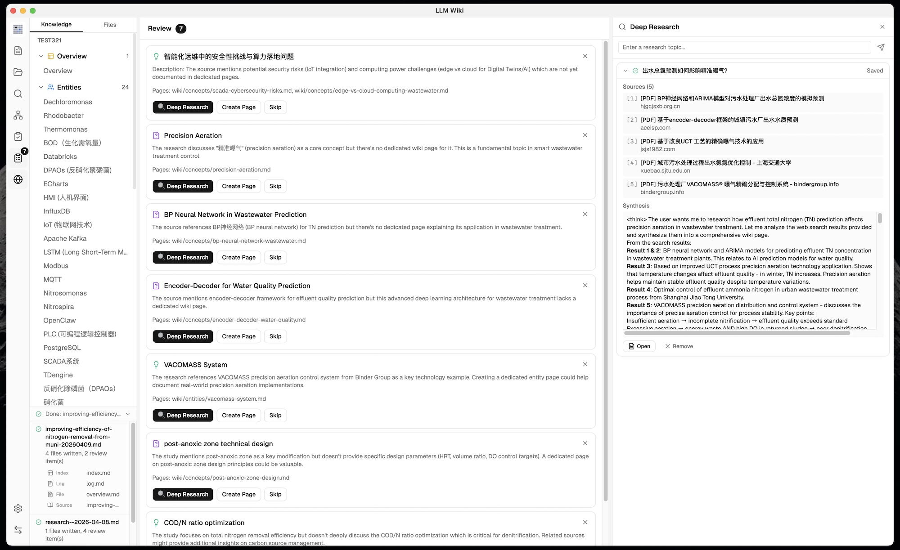
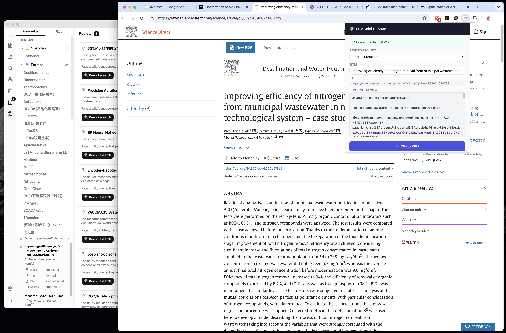

# LLM Wiki

<p align="center">
  
</p>

<p align="center">
  <strong>Kho tri thức cá nhân tự xây dựng.</strong><br>
  LLM đọc tài liệu của bạn, xây dựng wiki có cấu trúc và luôn giữ nó cập nhật.
</p>

<p align="center">
  <a href="#llm-wiki-là-gì">LLM Wiki là gì?</a> •
  <a href="#tính-năng">Tính năng</a> •
  <a href="#công-nghệ">Công nghệ</a> •
  <a href="#cài-đặt">Cài đặt</a> •
  <a href="#ghi-nhận">Ghi nhận</a> •
  <a href="#giấy-phép">Giấy phép</a>
</p>

<p align="center">
  Tiếng Việt | <a href="README.md">English</a> | <a href="README_CN.md">中文</a> | <a href="README_JA.md">日本語</a> | <a href="README_KO.md">한국어</a>
</p>

---

<p align="center">
  
</p>

## Tính năng

- **Nhập liệu chuỗi suy luận hai bước (Two-Step Chain-of-Thought)** — LLM phân tích trước, sau đó tạo trang wiki với khả năng truy vết nguồn và bộ nhớ đệm tăng dần
- **Nhập liệu hình ảnh đa phương thức (Multimodal)** — trích xuất ảnh nhúng từ PDF, tạo chú thích thực tế bằng LLM thị giác (vision LLM), hiển thị ảnh trong kết quả tìm kiếm nhận biết hình ảnh với xem trước phóng to (lightbox) và nhảy tới nguồn
- **Phân tích tài liệu đa định dạng** — nhập PDF, tài liệu Office, EPUB/MOBI, Org mode, hình ảnh, media, clip web và nhiều URL, với xử lý PDF bằng MinerU tích hợp sẵn, trên cloud hoặc chạy cục bộ
- **Cấu hình model linh hoạt** — cấu hình model theo từng dự án, định tuyến Chat và Ingest độc lập, quản lý provider tùy chỉnh, header và đầu ra streaming
- **Truy xuất bám nguồn** — dùng chế độ "Chỉ đọc nguồn" (Read Sources Only) để trả lời hoàn toàn dựa trên tài liệu gốc đã nhập
- **Quản lý & di chuyển dự án** — xuất/nhập toàn bộ kho lưu trữ dự án giữa các thiết bị, và xây dựng lại chỉ mục Wiki từ các trang hiện có
- **Đồ thị tri thức 4 tín hiệu** — mô hình liên quan gồm liên kết trực tiếp, trùng nguồn, Adamic-Adar và tương đồng loại trang
- **Phát hiện cộng đồng Louvain** — tự động phát hiện cụm tri thức kèm điểm gắn kết
- **Graph Insights** — phát hiện kết nối bất ngờ và khoảng trống tri thức, chỉ một cú nhấp chuột là chạy Deep Research
- **Tìm kiếm ngữ nghĩa vector** — truy xuất dựa trên embedding tùy chọn qua LanceDB, hỗ trợ mọi endpoint tương thích OpenAI
- **Hàng đợi nhập liệu bền bỉ** — xử lý tuần tự với phục hồi sau sự cố, hủy, thử lại và hiển thị tiến độ trực quan
- **Nhập thư mục** — nhập đệ quy thư mục, giữ nguyên cấu trúc thư mục; ngữ cảnh thư mục làm gợi ý phân loại cho LLM
- **Tự động theo dõi thư mục nguồn** — phát hiện thay đổi bên ngoài trong `raw/sources/` và đồng bộ nhập/xóa
- **Deep Research** — chủ đề tìm kiếm do LLM tối ưu, tìm kiếm web đa truy vấn qua Tavily, SerpApi hoặc SearXNG, tự động nhập kết quả vào wiki
- **Agent chat chạy trên backend Rust** — runtime chat dùng công cụ (tool-using) với truy xuất wiki/nguồn/đồ thị/web, tạo file trong workspace, phê duyệt shell, hủy và sự kiện công cụ theo streaming
- **Agent Skills** — quét và bật các thư mục `SKILL.md` cục bộ, chọn skill bằng `/skill`, để Agent đọc hướng dẫn skill khi cần
- **Xem trước đầu ra đã tạo** — các file Markdown, HTML, hình ảnh và file workspace khác do Agent tạo hiển thị dưới dạng đầu ra, có xem trước và truy cập nhanh tới thư mục
- **Hiển thị sơ đồ Mermaid** — hiển thị khối code Mermaid ngay trong chat và bản xem trước, với thẻ lỗi cú pháp gọn thay vì xuất nguyên văn lỗi parser
- **Hệ thống Review bất đồng bộ** — LLM đánh dấu các mục cần con người đánh giá, hành động định sẵn, truy vấn tìm kiếm tạo sẵn
- **Chrome Web Clipper** — chụp trang web bằng một cú nhấp chuột, tự động nhập vào kho tri thức
- **Local HTTP API + MCP Server + AI Agent Skill** — API JSON tích hợp sẵn tại `127.0.0.1:19828` và MCP server đóng gói kèm cho tìm kiếm hybrid, đọc file, duyệt đồ thị và quét lại nguồn; [agent skill](https://github.com/nashsu/llm_wiki_skill) có sẵn cài vào Claude Code / Codex chỉ bằng một lệnh (`npx skills add …`)

## LLM Wiki là gì?

LLM Wiki là ứng dụng desktop đa nền tảng biến tài liệu của bạn thành kho tri thức được tổ chức, liên kết chéo — hoàn toàn tự động. Thay vì RAG truyền thống (truy xuất rồi trả lời lại từ đầu mỗi lần), LLM **tăng dần xây dựng và duy trì một wiki bền vững** từ các nguồn của bạn. Tri thức được biên dịch một lần và luôn được cập nhật, thay vì suy diễn lại trên mỗi truy vấn.

Dự án này dựa trên [mẫu LLM Wiki của Karpathy](https://gist.github.com/karpathy/442a6bf555914893e9891c11519de94f) — một phương pháp luận xây dựng kho tri thức cá nhân bằng LLM. llm_wiki được tạo và duy trì bởi [nash_su](https://x.com/nash_su), người đã triển khai các ý tưởng cốt lõi thành một ứng dụng desktop hoàn chỉnh với nhiều cải tiến đáng kể.

<p align="center">
  
</p>

## Ghi nhận

Phương pháp luận nền tảng đến từ tài liệu [llm-wiki.md](https://gist.github.com/karpathy/442a6bf555914893e9891c11519de94f) của **Andrej Karpathy**, mô tả mẫu dùng LLM để tăng dần xây dựng và duy trì wiki cá nhân. Tài liệu gốc là một mẫu thiết kế trừu tượng; dự án này là một triển khai cụ thể với nhiều mở rộng quan trọng.

## Những gì giữ lại từ bản gốc

Kiến trúc cốt lõi tuân thủ trung thành thiết kế của Karpathy:

- **Kiến trúc ba lớp**: Raw Sources (nguồn thô, bất biến) → Wiki (do LLM tạo) → Schema (quy tắc & cấu hình)
- **Ba thao tác cốt lõi**: Ingest, Query, Lint
- **index.md** là danh mục nội dung và điểm vào điều hướng của LLM
- **log.md** là bản ghi thao tác theo thời gian với định dạng có thể phân tích
- Cú pháp **[[wikilink]]** cho tham chiếu chéo
- **YAML frontmatter** trên mọi trang wiki
- **Tương thích Obsidian** — thư mục wiki hoạt động như một Obsidian vault
- **Con người quản lý, LLM duy trì** — sự phân vai cơ bản

<p align="center">
  
</p>

## Những gì đã thay đổi & bổ sung

### 1. Từ CLI thành ứng dụng Desktop

Bản gốc là tài liệu mẫu trừu tượng, thiết kế để copy-paste cho LLM agent. Chúng tôi xây dựng nó thành một **ứng dụng desktop đa nền tảng hoàn chỉnh** với:
- **Bố cục ba cột**: Cây tri thức / Cây file (trái) + Chat (giữa) + Xem trước (phải)
- **Thanh sidebar biểu tượng** để chuyển đổi giữa Wiki, Nguồn, Tìm kiếm, Đồ thị, Lint, Review, Deep Research, Cài đặt
- **Panel tùy chỉnh kích thước** — kéo để đổi kích thước panel trái/phải với giới hạn min/max
- **Panel hoạt động (Activity panel)** — trạng thái xử lý thời gian thực, hiển thị tiến độ nhập từng file
- **Mọi trạng thái được lưu bền** — hội thoại, cài đặt, mục review, cấu hình dự án tồn tại sau khi khởi động lại
- **Mẫu kịch bản (Scenario templates)** — Nghiên cứu, Đọc sách, Phát triển bản thân, Kinh doanh, Chung — mỗi mẫu cấu hình sẵn purpose.md và schema.md

### 2. Purpose.md — Linh hồn của Wiki

Bản gốc có Schema (wiki vận hành thế nào) nhưng không có nơi chính thức cho **mục đích** tồn tại của wiki. Chúng tôi thêm `purpose.md`:
- Định nghĩa mục tiêu, câu hỏi chính, phạm vi nghiên cứu, luận đề đang phát triển
- LLM đọc nó trong mỗi lần ingest và query để lấy ngữ cảnh
- LLM có thể đề xuất cập nhật dựa trên mẫu sử dụng
- Khác với schema — schema là quy tắc cấu trúc, purpose là định hướng ý đồ

### 3. Nhập liệu chuỗi suy luận hai bước

Bản gốc mô tả nhập một bước, trong đó LLM đọc và ghi đồng thời. Chúng tôi tách thành **hai lần gọi LLM nối tiếp** cho chất lượng tốt hơn hẳn:

```
Step 1 (Analysis): LLM đọc nguồn → phân tích có cấu trúc
  - Thực thể, khái niệm, luận điểm chính
  - Liên kết với nội dung wiki hiện có
  - Mâu thuẫn & căng thẳng với tri thức hiện có
  - Khuyến nghị về cấu trúc wiki

Step 2 (Generation): LLM lấy kết quả phân tích → tạo file wiki
  - Tóm tắt nguồn kèm frontmatter (type, title, sources[])
  - Trang thực thể, trang khái niệm kèm tham chiếu chéo
  - Cập nhật index.md, log.md, overview.md
  - Mục review cho con người đánh giá
  - Truy vấn tìm kiếm cho Deep Research
```

Các cải tiến nhập liệu khác vượt ngoài bản gốc:
- **Bộ nhớ đệm tăng dần SHA256** — nội dung file nguồn được hash trước khi nhập; file không thay đổi tự động bị bỏ qua, tiết kiệm token LLM và thời gian
- **Hàng đợi nhập liệu bền bỉ** — xử lý tuần tự ngăn các lần gọi LLM đồng thời; hàng đợi lưu trên đĩa, tồn tại sau khi khởi động lại app; task thất bại tự động thử lại tối đa 3 lần
- **Nhập thư mục** — nhập đệ quy thư mục, giữ nguyên cấu trúc thư mục; đường dẫn thư mục được đưa cho LLM làm ngữ cảnh phân loại (ví dụ: "papers > energy" giúp phân loại nội dung)
- **Tự động theo dõi thư mục nguồn** — file thêm, sửa hoặc xóa trong `raw/sources/` bên ngoài app được nhận tự động và dùng lại cùng vòng đời nhập/xóa như thao tác trong app
- **Hiển thị hàng đợi trực quan** — Activity Panel hiển thị thanh tiến độ, các task đang chờ/đang xử lý/thất bại kèm nút hủy và thử lại
- **Tự động embedding** — khi bật tìm kiếm vector, các trang mới tự động được nhúng (embedded) sau khi nhập
- **Truy vết nguồn** — mỗi trang wiki được tạo đều có trường `sources: []` trong YAML frontmatter, liên kết ngược tới các file nguồn thô đã đóng góp
- **Tự động cập nhật overview.md** — trang tóm tắt toàn cục được tái tạo sau mỗi lần nhập để phản ánh trạng thái mới nhất của wiki
- **Đảm bảo có tóm tắt nguồn** — cơ chế dự phòng đảm bảo trang tóm tắt nguồn luôn được tạo, ngay cả khi LLM bỏ sót
- **Tạo nội dung theo ngôn ngữ** — LLM trả lời bằng ngôn ngữ người dùng đã cấu hình (tiếng Anh hoặc tiếng Trung)
- **Chế độ xem Nguồn tiến dần** — thư mục nguồn lớn hiển thị tiến dần khi cuộn, giữ cho tập nguồn lớn vẫn mượt mà

### 4. Đồ thị tri thức với mô hình liên quan

<p align="center">
  
</p>

Bản gốc đề cập `[[wikilinks]]` cho tham chiếu chéo nhưng không có phân tích đồ thị. Chúng tôi xây dựng **trực quan hóa đồ thị tri thức đầy đủ và công cụ tính liên quan**:

**Mô hình liên quan 4 tín hiệu:**
| Tín hiệu | Trọng số | Mô tả |
|--------|--------|-------------|
| Liên kết trực tiếp | ×3.0 | Các trang liên kết qua `[[wikilinks]]` |
| Trùng nguồn | ×4.0 | Các trang dùng chung nguồn thô (qua frontmatter `sources[]`) |
| Adamic-Adar | ×1.5 | Các trang có lân cận chung (trọng số theo bậc của lân cận) |
| Tương đồng loại trang | ×1.0 | Cộng điểm khi cùng loại trang (thực thể↔thực thể, khái niệm↔khái niệm) |

**Trực quan hóa đồ thị (sigma.js + graphology + ForceAtlas2):**
- Màu node theo loại trang hoặc cộng đồng, kích thước node theo số liên kết (tỉ lệ √)
- Độ dày và màu cạnh theo trọng số liên quan (xanh lá=mạnh, xám=yếu)
- Tương tác hover: lân cận giữ nguyên, các node còn lại mờ đi, cạnh nổi bật kèm nhãn điểm liên quan
- Điều khiển zoom (ZoomIn, ZoomOut, vừa màn hình)
- Bộ nhớ đệm vị trí ngăn bố cục nhảy khi dữ liệu cập nhật
- Chú thích chuyển giữa đếm theo loại và thông tin cộng đồng tùy chế độ tô màu

### 5. Phát hiện cộng đồng Louvain

Không có trong bản gốc. Tự động phát hiện cụm tri thức bằng **thuật toán Louvain** (graphology-communities-louvain):

- **Tự động gom cụm** — phát hiện các trang tự nhiên nhóm lại với nhau dựa trên cấu trúc liên kết, độc lập với loại trang định sẵn
- **Chuyển đổi Loại / Cộng đồng** — chuyển giữa tô màu node theo loại trang (thực thể, khái niệm, nguồn...) hoặc theo cụm tri thức đã phát hiện
- **Điểm gắn kết (cohesion scoring)** — mỗi cộng đồng được chấm theo mật độ cạnh nội bộ (cạnh thực tế / cạnh khả dĩ); cụm gắn kết thấp (< 0,15) được gắn cờ cảnh báo
- **Bảng màu 12 màu** — phân tách trực quan rõ ràng giữa các cụm
- **Chú thích cộng đồng** — hiển thị nhãn node nổi bật, số thành viên và độ gắn kết của từng cụm

<p align="center">
  
</p>

### 6. Graph Insights — Kết nối bất ngờ & khoảng trống tri thức

Không có trong bản gốc. Hệ thống **tự động phân tích cấu trúc đồ thị** để đưa ra các gợi ý hành động:

**Kết nối bất ngờ:**
- Phát hiện quan hệ bất ngờ: cạnh xuyên cộng đồng, liên kết xuyên loại, cặp ngoại vi↔trung tâm
- Xếp hạng bằng điểm bất ngờ tổng hợp để nêu bật các kết nối đáng chú ý nhất
- Có thể bỏ qua — đánh dấu kết nối đã xem để không hiện lại

**Khoảng trống tri thức:**
- **Trang cô lập** (bậc ≤ 1) — các trang có ít hoặc không có liên kết với phần còn lại của wiki
- **Cộng đồng thưa** (gắn kết < 0,15, ≥ 3 trang) — lĩnh vực tri thức có tham chiếu chéo nội bộ yếu
- **Node cầu nối** (nối 3+ cụm) — các trang nút giao quan trọng giữ nhiều lĩnh vực tri thức lại với nhau

**Tương tác:**
- Nhấp vào thẻ insight để **làm nổi bật** các node và cạnh tương ứng trên đồ thị; nhấp lại để bỏ chọn
- Khoảng trống tri thức và node cầu nối có **nút Deep Research** — kích hoạt nghiên cứu do LLM tối ưu với chủ đề theo miền (đọc overview.md + purpose.md lấy ngữ cảnh)
- Chủ đề nghiên cứu hiển thị trong **hộp thoại xác nhận có thể chỉnh sửa** trước khi bắt đầu — người dùng có thể tinh chỉnh chủ đề và truy vấn tìm kiếm

<p align="center">
  
</p>

### 7. Pipeline truy xuất truy vấn tối ưu

Bản gốc mô tả một truy vấn đơn giản, trong đó LLM đọc các trang liên quan. Chúng tôi xây dựng **pipeline truy xuất đa giai đoạn** với tìm kiếm vector tùy chọn và kiểm soát ngân sách:

```
Giai đoạn 1: Tìm kiếm token hóa
  - Tiếng Anh: tách từ + loại bỏ stop word
  - Tiếng Trung: tách bigram CJK (每个 → [每个, 个…])
  - Cộng điểm khớp tiêu đề (+10 điểm)
  - Tìm cả trong wiki/ và raw/sources/

Giai đoạn 1.5: Tìm kiếm ngữ nghĩa vector (tùy chọn)
  - Embedding qua mọi endpoint /v1/embeddings tương thích OpenAI
  - Lưu trong LanceDB (backend Rust) để truy xuất ANN nhanh
  - Tương đồng cosine tìm trang liên quan ngữ nghĩa ngay cả khi không trùng từ khóa
  - Kết quả gộp vào tìm kiếm: tăng điểm cho kết quả đã có + thêm phát hiện mới

Giai đoạn 2: Mở rộng đồ thị
  - Kết quả tìm kiếm top làm node hạt giống
  - Mô hình liên quan 4 tín hiệu tìm trang liên quan
  - Duyệt 2 bước (2-hop) có suy giảm cho liên kết sâu hơn

Giai đoạn 3: Kiểm soát ngân sách
  - Cửa sổ ngữ cảnh cấu hình được: 4K → 1M token
  - Phân bổ theo tỉ lệ: 60% trang wiki, 20% lịch sử chat, 5% index, 15% system
  - Trang được ưu tiên theo điểm liên quan kết hợp tìm kiếm + đồ thị

Giai đoạn 4: Lắp ráp ngữ cảnh
  - Trang đánh số với đầy đủ nội dung (không chỉ tóm tắt)
  - System prompt gồm: purpose.md, quy tắc ngôn ngữ, định dạng trích dẫn, index.md
  - Hướng dẫn LLM trích dẫn trang theo số: [1], [2], v.v.
```

**Tìm kiếm vector** hoàn toàn tùy chọn — mặc định tắt, bật trong Cài đặt với endpoint, API key và model cấu hình độc lập. Khi tắt, pipeline chuyển về tìm kiếm token hóa + mở rộng đồ thị. Đo lường: độ phủ tổng thể tăng từ 58,2% lên 71,4% khi bật tìm kiếm vector.

### 8. Chat đa hội thoại có lưu bền

Bản gốc chỉ có một giao diện truy vấn duy nhất. Chúng tôi xây dựng **hỗ trợ đa hội thoại đầy đủ**:

- **Phiên chat độc lập** — tạo, đổi tên, xóa hội thoại
- **Sidebar hội thoại** — chuyển nhanh giữa các chủ đề
- **Lưu bền theo hội thoại** — mỗi hội thoại lưu tại `.llm-wiki/chats/{id}.json`
- **Độ sâu lịch sử cấu hình được** — giới hạn số tin nhắn gửi làm ngữ cảnh (mặc định: 10)
- **Panel tham chiếu được trích dẫn** — mục thu gọn trên mỗi phản hồi cho biết trang wiki nào đã dùng, nhóm theo loại kèm biểu tượng
- **Lưu bền tham chiếu** — các trang được trích dẫn lưu trực tiếp trong dữ liệu tin nhắn, ổn định sau khi khởi động lại
- **Tạo lại** — tạo lại phản hồi cuối bằng một cú nhấp chuột (xóa cặp tin nhắn trợ lý + người dùng cuối, gửi lại)
- **Lưu vào Wiki** — lưu trữ câu trả lời giá trị vào `wiki/queries/`, rồi tự động nhập để trích xuất thực thể/khái niệm vào mạng tri thức

### 9. Agent chat chạy trên backend Rust & Skills

Không có trong bản gốc. Chat giờ chạy qua runtime Agent trên backend Rust thay vì vòng lặp TypeScript chỉ trong trình duyệt:

- **Agent dùng công cụ** — có thể chọn tìm kiếm wiki, tìm kiếm nguồn, tìm kiếm đồ thị, tìm kiếm web, AnyTXT, công cụ file workspace, lệnh shell được phê duyệt và đọc file skill
- **Quản lý skill** — quét thư mục skill của dự án và người dùng, bật/tắt skill, và chọn skill theo hội thoại bằng gợi ý hoàn thiện `/skill`
- **Đầu ra workspace đã tạo** — file do công cụ Agent tạo được giữ trong `agent-workspace/`, hiển thị dưới dạng đầu ra đã tạo, có thể xem trước hoặc mở từ chat
- **Form tương tác người dùng** — skill có thể yêu cầu nhập liệu có cấu trúc như chọn một, chọn nhiều hoặc văn bản tự do mà không cần hardcode UI riêng cho từng skill
- **Mô hình thực thi an toàn hơn** — lệnh workspace của dự án chạy trơn tru, trong khi lệnh shell bên ngoài vẫn cần phê duyệt rõ ràng

### 10. Hiển thị tư duy / suy luận (Thinking / Reasoning)

Không có trong bản gốc. Đối với LLM phát ra khối `<think>` (DeepSeek, QwQ, v.v.):

- **Hiển thị thinking theo streaming** — hiển thị cuộn 5 dòng với hiệu ứng mờ dần trong lúc tạo
- **Thu gọn mặc định** — khối thinking ẩn sau khi hoàn thành, nhấp để mở rộng
- **Tách biệt trực quan** — nội dung thinking hiển thị theo phong cách riêng, tách khỏi phản hồi chính

### 11. Hiển thị Markdown: công thức KaTeX & sơ đồ Mermaid

Không có trong bản gốc. Hiển thị Markdown phong phú trên chat và bản xem trước:

- **Hiển thị KaTeX** — công thức nội dòng `$...$` và khối `$$...$$` được hiển thị qua remark-math + rehype-katex
- **Plugin toán học Milkdown** — trình soạn thảo xem trước hiển thị toán học nguyên bản qua @milkdown/plugin-math
- **Tự phát hiện** — các môi trường LaTeX trần như `\begin{aligned}` tự động được bọc bằng dấu phân cách `$$`
- **Dự phòng Unicode** — ánh xạ 100+ ký hiệu (α, ∑, →, ≤, v.v.) cho ký hiệu nội dòng đơn giản ngoài khối toán học
- **Khối code Mermaid** — sơ đồ `mermaid` trong fence hiển thị trực tiếp thành lưu đồ, sơ đồ tuần tự và các dạng hình ảnh Mermaid hỗ trợ
- **Lỗi Mermaid gọn** — lỗi cú pháp được gom trong một thẻ lỗi nhỏ thay vì tràn nguyên văn đầu ra parser vào chat

### 12. Hệ thống Review (con người trong vòng lặp, bất đồng bộ)

Bản gốc gợi ý người dùng nên tham gia trong lúc nhập. Chúng tôi thêm **hàng đợi review bất đồng bộ**:

- LLM đánh dấu các mục cần con người đánh giá trong lúc nhập
- **Loại hành động định sẵn**: Tạo trang, Deep Research, Bỏ qua — giới hạn để ngăn LLM tự bịa hành động tùy ý
- **Truy vấn tìm kiếm tạo tại lúc nhập** — LLM tạo sẵn truy vấn tìm kiếm web tối ưu cho mỗi mục review
- Người dùng xử lý review khi thuận tiện — không chặn việc nhập

### 13. Deep Research

<p align="center">
  
</p>

Không có trong bản gốc. Khi LLM phát hiện khoảng trống tri thức:

- **Tìm kiếm web** qua Tavily, SerpApi hoặc SearXNG tìm nguồn liên quan với trích xuất toàn văn (không cắt ngắn)
- **Cấu hình theo provider** — Tavily và SerpApi dùng API key độc lập; SerpApi hỗ trợ chọn engine, còn SearXNG dùng URL instance đã cấu hình và danh mục tìm kiếm
- **Nhiều truy vấn tìm kiếm** cho mỗi chủ đề — do LLM tạo tại lúc nhập, tối ưu cho công cụ tìm kiếm
- **Chủ đề nghiên cứu do LLM tối ưu** — khi kích hoạt từ Graph Insights, LLM đọc overview.md + purpose.md để tạo chủ đề và truy vấn theo miền (không phải từ khóa chung chung)
- **Hộp thoại xác nhận của người dùng** — chủ đề và truy vấn tìm kiếm có thể chỉnh sửa, hiển thị để xem trước khi bắt đầu nghiên cứu
- **LLM tổng hợp** phát hiện thành trang wiki nghiên cứu kèm tham chiếu chéo tới wiki hiện có
- **Hiển thị thinking** — khối `<think>` hiển thị dưới dạng mục thu gọn trong lúc tổng hợp, tự cuộn tới nội dung mới nhất
- **Tự động nhập** — kết quả nghiên cứu tự động được xử lý để trích xuất thực thể/khái niệm vào wiki
- **Hàng đợi task** với 3 task đồng thời
- **Panel Nghiên cứu** — panel sidebar riêng với chiều cao động, tiến độ streaming thời gian thực

### 14. Tiện ích trình duyệt (Web Clipper)

<p align="center">
  
</p>

Bản gốc đề cập Obsidian Web Clipper. Chúng tôi xây dựng **tiện ích Chrome chuyên dụng** (Manifest V3):

- **Mozilla Readability.js** để trích xuất bài viết chính xác (loại bỏ quảng cáo, điều hướng, sidebar)
- **Turndown.js** để chuyển HTML → Markdown có hỗ trợ bảng
- **Chọn dự án** — chọn wiki để clip vào (hỗ trợ đa dự án)
- **Local HTTP API** (cổng 19827, tiny_http) — giao tiếp Tiện ích ↔ App
- **Tự động nhập** — nội dung clip tự động kích hoạt pipeline nhập hai bước
- **Theo dõi clip** — quét mỗi 3 giây tìm clip mới, tự động xử lý
- **Xem trước ngoại tuyến** — hiển thị nội dung đã trích xuất ngay cả khi app không chạy

### 15. Hỗ trợ tài liệu đa định dạng

Bản gốc tập trung vào văn bản/markdown. Chúng tôi hỗ trợ trích xuất có cấu trúc, giữ ngữ nghĩa tài liệu:

| Định dạng | Phương pháp |
|--------|--------|
| PDF | pdf-extract tích hợp sẵn (Rust) kèm bộ nhớ đệm file; tùy chọn phân tích MinerU Cloud, Local API hoặc Pipeline cho bố cục phức tạp |
| DOCX | docx-rs — tiêu đề, đậm/nghiêng, danh sách, bảng → Markdown có cấu trúc |
| PPTX | ZIP + XML — trích xuất từng slide với cấu trúc tiêu đề/danh sách |
| XLSX/XLS/ODS | calamine — kiểu ô đúng, hỗ trợ nhiều sheet, bảng Markdown |
| EPUB/MOBI | Metadata, chương và nội dung sách điện tử → nội dung sẵn sàng nhập |
| Hình ảnh | Xem trước nguyên bản (png, jpg, gif, webp, svg, v.v.) |
| Video/Âm thanh | Trình phát tích hợp |
| Clip web | Readability.js + Turndown.js → Markdown sạch |

> MinerU là tùy chọn. Dùng MinerU Cloud, endpoint Local API chính thức, hoặc chế độ Local Pipeline cho PDF phức tạp. Các chế độ cục bộ giữ xử lý trên máy của bạn, và ảnh trích xuất được lưu trong thư mục `wiki/media` do dự án quản lý. Nếu MinerU thất bại, LLM Wiki chuyển về parser tích hợp sẵn.

### 16. Xóa file kèm dọn dẹp dây chuyền

Bản gốc không có cơ chế xóa. Chúng tôi thêm **xóa dây chuyền thông minh**:

- Xóa file nguồn sẽ xóa trang tóm tắt wiki của nó
- **Khớp 3 phương pháp** tìm các trang wiki liên quan: trường `sources[]` trong frontmatter, tên trang tóm tắt nguồn, tham chiếu mục frontmatter
- **Bảo toàn thực thể dùng chung** — trang thực thể/khái niệm liên kết với nhiều nguồn chỉ bị gỡ nguồn đã xóa khỏi mảng `sources[]`, không bị xóa hoàn toàn
- **Dọn index** — các trang đã gỡ được xóa khỏi index.md
- **Dọn wikilink** — các `[[wikilinks]]` chết trỏ tới trang đã xóa được gỡ khỏi các trang wiki còn lại

### 17. Cửa sổ ngữ cảnh cấu hình được

Không có trong bản gốc. Người dùng có thể cấu hình lượng ngữ cảnh LLM nhận:

- **Thanh trượt từ 4K tới 1M token** — thích ứng với khả năng của từng LLM
- **Phân bổ ngân sách theo tỉ lệ** — cửa sổ lớn hơn nhận tỉ lệ nội dung wiki nhiều hơn
- **Tỉ lệ 60/20/5/15** — trang wiki / lịch sử chat / index / system prompt

### 18. Tương thích đa nền tảng

Bản gốc không phụ thuộc nền tảng (mẫu trừu tượng). Chúng tôi xử lý các vấn đề đa nền tảng cụ thể:

- **Chuẩn hóa đường dẫn** — `normalizePath()` thống nhất dùng trên hơn 22 file, backslash → forward slash
- **Xử lý chuỗi an toàn Unicode** — cắt theo ký tự thay vì theo byte (tránh crash với tên file CJK)
- **macOS đóng-để-ẩn** — nút đóng ẩn cửa sổ (app vẫn chạy nền), nhấp icon dock để khôi phục, Cmd+Q để thoát
- **Windows/Linux xác nhận đóng** — hộp thoại xác nhận trước khi thoát để tránh mất dữ liệu do vô ý
- **Tauri v2** — desktop nguyên bản trên macOS, Windows, Linux
- **GitHub Actions CI/CD** — build tự động cho macOS (Apple Silicon), Windows (.msi), Linux (.deb / .AppImage)

### 19. Các bổ sung khác

- **i18n** — giao diện tiếng Anh + tiếng Trung (react-i18next)
- **Lưu bền cài đặt** — provider LLM, API key, model, kích thước ngữ cảnh, ngôn ngữ được lưu qua Tauri Store
- **Cấu hình Obsidian** — thư mục `.obsidian/` tự tạo với cài đặt khuyến nghị
- **Hiển thị Markdown** — bảng GFM có viền, khối code đúng chuẩn, xử lý wikilink trong chat và bản xem trước
- **Hỗ trợ LLM đa provider** — OpenAI, Anthropic, Google, Ollama, Custom — mỗi provider có streaming và header riêng
- **Timeout LLM cấu hình được** — điều chỉnh timeout yêu cầu cho model cục bộ chậm và thao tác chạy lâu
- **Firecrawl cấu hình được** — tùy chọn API key và Base URL tùy chỉnh cho dịch vụ hosted hoặc tự host
- **Sidebar file thu gọn được** — thu gọn điều hướng Tri thức/File mà vẫn giữ trạng thái
- **Bảo trì dự án** — xuất/nhập ZIP để di chuyển và xây dựng lại `wiki/index.md` một cách xác định
- **Tín hiệu dataVersion** — đồ thị và UI tự làm mới khi nội dung wiki thay đổi

## Công nghệ

| Lớp | Công nghệ |
|-------|-----------|
| Desktop | Tauri v2 (backend Rust) |
| Frontend | React 19 + TypeScript + Vite |
| UI | shadcn/ui + Tailwind CSS v4 |
| Editor | Milkdown (WYSIWYG dựa trên ProseMirror) |
| Graph | sigma.js + graphology + ForceAtlas2 |
| Tìm kiếm | Tìm kiếm token hóa + liên quan đồ thị + vector tùy chọn (LanceDB) |
| Vector DB | LanceDB (Rust, nhúng, tùy chọn) |
| Tài liệu | pdf-extract + MinerU Cloud/Local + docx-rs + calamine + trích xuất EPUB/MOBI |
| i18n | react-i18next |
| State | Zustand |
| LLM | Streaming fetch (OpenAI, Anthropic, Google, Ollama, Custom) |
| Tìm kiếm web | Tavily, SerpApi, SearXNG JSON API |

## Cài đặt

### Bản build sẵn

Tải về từ [Releases](https://github.com/nashsu/llm_wiki/releases):
- **macOS**: `.dmg` (Apple Silicon)
- **Windows**: `.msi`
- **Linux**: `.deb` / `.AppImage`

### Build từ mã nguồn

```bash
# Điều kiện: Node.js 20+, Rust 1.88+, protoc
#   macOS:  brew install protobuf
#   Linux:  sudo apt install protobuf-compiler
#   Windows: choco install protoc
git clone https://github.com/nashsu/llm_wiki.git
cd llm_wiki
npm install
npm --prefix mcp-server ci && npm run mcp:build   # mcp-server/dist được đóng gói như một Tauri resource
npm run tauri dev      # Phát triển
npm run tauri build    # Build production
```

### Tiện ích Chrome

1. Mở `chrome://extensions`
2. Bật "Developer mode"
3. Nhấn "Load unpacked"
4. Chọn thư mục `extension/`
5. Clip trang hiện tại bằng `Alt+Shift+L` (`Command+Shift+L` trên macOS). Tùy chỉnh tại `chrome://extensions/shortcuts`.

## Bắt đầu nhanh

1. Mở app → Tạo dự án mới (chọn một mẫu)
2. Vào **Cài đặt** → Cấu hình provider LLM (API key + model)
3. Tùy chọn: cấu hình provider **Tìm kiếm web** và tự động theo dõi thư mục nguồn trong Cài đặt
4. Vào **Nguồn** → Nhập tài liệu (PDF, DOCX, MD, v.v.)
5. Xem **Activity Panel** — LLM tự động xây dựng các trang wiki
6. Dùng **Chat** để truy vấn kho tri thức
7. Duyệt **Đồ thị tri thức** để xem các liên kết
8. Kiểm tra **Review** cho các mục cần bạn chú ý
9. Chạy **Lint** định kỳ để duy trì sức khỏe wiki

## Local HTTP API + MCP Server + AI Agent Skill

LLM Wiki đi kèm local HTTP API tích hợp sẵn tại `http://127.0.0.1:19828` (bảo vệ bằng token, chỉ `127.0.0.1`) để các công cụ bên ngoài — bao gồm AI agent như **Claude Code**, **Codex** hoặc bất kỳ script nào có khả năng HTTP — có thể truy vấn wiki của bạn:

- `GET /api/v1/health` — trạng thái server (không cần auth)
- `GET /api/v1/projects` — liệt kê dự án
- `GET /api/v1/projects/{id}/files` / `files/content` — đọc file và nội dung
- `GET /api/v1/projects/{id}/reviews?status=unresolved` — xuất các mục tab Review để bảo trì wiki (`status`: `unresolved`, `resolved` hoặc `all`; tùy chọn `type` và `limit`)
- `PATCH /api/v1/projects/{id}/reviews/{reviewId}` — cập nhật một mục Review (JSON body `{ "resolved": true, "action": "label" }`; `resolved` mặc định là true, truyền false để mở lại)
- `POST /api/v1/projects/{id}/reviews/resolve` — giải quyết hàng loạt mục Review (JSON body `{ "ids": [...], "action": "label" }`), trả về `{ resolved, notFound, count }`; nút Refresh của tab Review đọc lại kết quả từ đĩa
- `POST /api/v1/projects/{id}/search` — truy xuất **hybrid** (từ khóa + vector) trả về `mode`, `tokenHits`, `vectorHits`, `vectorScore` cho từng kết quả
- `POST /api/v1/projects/{id}/chat` — endpoint chat Agent trên backend cho truy xuất wiki/nguồn/web/AnyTXT. Yêu cầu JSON mặc định không streaming; gửi `"stream": true` hoặc `Accept: text/event-stream` để nhận sự kiện SSE (`meta`, `agent` tăng dần, rồi `done`, `cancelled` hoặc `error`). Frame `done` cuối chứa toàn bộ phản hồi gộp, vì vậy client không nên hiển thị cả delta tin nhắn lẫn tin nhắn cuối như hai câu trả lời riêng biệt. `mode: "deep"` mở rộng thu thập bằng chứng, trong khi workspace Deep Research đầy đủ vẫn có trong UI desktop
- `GET /api/v1/projects/{id}/graph` — đồ thị wikilinks; hỗ trợ `q`, `nodeType`, `limit` (tối đa 1000), `offset` và `edgeScope=page|filtered`, trả về `totalCount` / `hasMore` cho dự án lớn
- `POST /api/v1/projects/{id}/sources/rescan` — kích hoạt quét lại nguồn từ backend
- `POST /api/v1/projects/{id}/pages/embed` — index một trang `wiki/*.md` do bên ngoài tạo hoặc cập nhật mà không cần build lại toàn bộ vector database

Bật API, tạo token và chọn có cho phép truy cập cục bộ không xác thực trong **Cài đặt → API + MCP**.

Đối với client tương thích MCP, LLM Wiki cũng gồm một MCP server cục bộ trong `mcp-server/`. Sau khi build bằng `npm run mcp:build`, **Cài đặt → API + MCP** hiển thị cấu hình MCP client có thể copy với đường dẫn cục bộ đúng cho máy của bạn. Các công cụ MCP gọi cùng bề mặt API, vì vậy agent client có thể liệt kê dự án, đọc file, xuất các mục Review chưa giải quyết, chạy tìm kiếm hybrid, xem đồ thị, kích hoạt quét lại nguồn và gọi cùng endpoint chat Agent trên backend Rust mà không cần code nối HTTP tùy chỉnh.

### Kết nối AI agent của bạn chỉ bằng một lệnh

Một **agent skill** sẵn dùng cho LLM Wiki nằm ở repo riêng. Cài vào Claude Code / Codex / bất kỳ runtime tương thích skill nào:

```bash
npx skills add https://github.com/nashsu/llm_wiki_skill.git --skill llm-wiki
```

Sau khi cài, agent có thể trả lời các prompt như "what does my LLM Wiki say about X", "search my 知识库 for Y", "show the neighborhood of node Z in my wiki graph" và "rescan my wiki sources" bằng cách nói chuyện với app đang chạy cục bộ của bạn — mặc định chỉ đọc, trích dẫn đường dẫn trang wiki để bạn kiểm chứng trong app.

- **Skill repo**: <https://github.com/nashsu/llm_wiki_skill>
- **Kỷ luật kích hoạt**: nó cố ý **không** kích hoạt với các câu chung chung như "search my notes" / "check my Obsidian / Notion / Logseq" — chỉ khi bạn nêu rõ LLM Wiki / `my wiki` / `知识库`.

## Cấu trúc dự án

```
my-wiki/
├── purpose.md              # Mục tiêu, câu hỏi chính, phạm vi nghiên cứu
├── schema.md               # Quy tắc cấu trúc wiki, loại trang
├── raw/
│   ├── sources/            # Tài liệu đã tải lên (bất biến)
│   └── assets/             # Hình ảnh cục bộ
├── wiki/
│   ├── index.md            # Danh mục nội dung
│   ├── log.md              # Lịch sử thao tác
│   ├── overview.md         # Tóm tắt toàn cục (tự động cập nhật)
│   ├── entities/           # Con người, tổ chức, sản phẩm
│   ├── concepts/           # Lý thuyết, phương pháp, kỹ thuật
│   ├── sources/            # Tóm tắt nguồn
│   ├── queries/            # Câu trả lời chat đã lưu + nghiên cứu
│   ├── synthesis/          # Phân tích xuyên nguồn
│   └── comparisons/        # So sánh song song
├── .obsidian/              # Cấu hình Obsidian vault (tự tạo)
└── .llm-wiki/              # Cấu hình app, lịch sử chat, mục review
```

## Lịch sử Star

<a href="https://www.star-history.com/?repos=nashsu%2Fllm_wiki&type=date&legend=top-left">
 <picture>
   <source media="(prefers-color-scheme: dark)" srcset="https://api.star-history.com/chart?repos=nashsu/llm_wiki&type=date&theme=dark&legend=top-left" />
   <source media="(prefers-color-scheme: light)" srcset="https://api.star-history.com/chart?repos=nashsu/llm_wiki&type=date&legend=top-left" />
   
 </picture>
</a>

## Giấy phép

Dự án này được cấp phép theo **GNU General Public License v3.0** — xem [LICENSE](LICENSE) để biết chi tiết.
